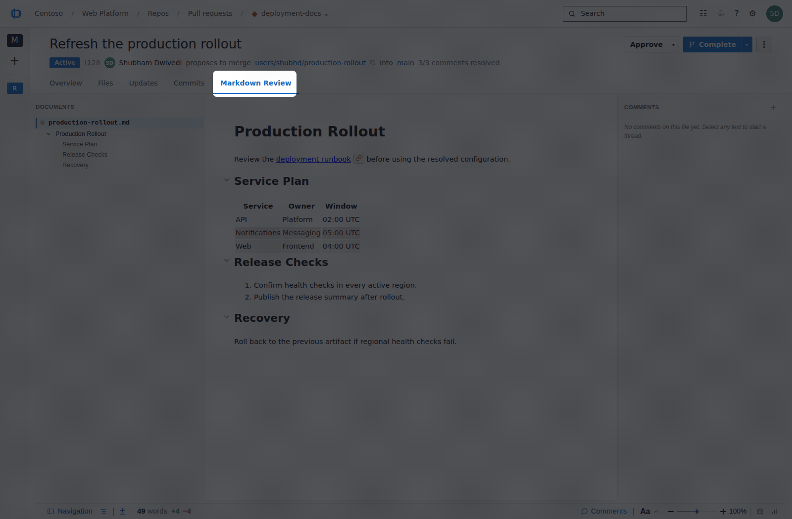

# Easy Markdown Review

[](https://github.com/shudv/easy-markdown-review-ado/actions/workflows/ci.yml)
[](https://github.com/shudv/easy-markdown-review-ado/releases/latest)
[](LICENSE)

Review Markdown like a document, directly in Azure DevOps. Comment on rendered
documents and see exactly what changed.



## Features

- **Pull-Request Tab:** Comment on rendered Markdown and see exactly what changed in a PR.
- **Document Hub:** Central place for all your Markdown documents with all the same reading and commenting capabilities. Understands Azure DevOps wiki syntax (`[[_TOC_]]`, `[[_TOSP_]]`, `.order`).
- **Equations and diagrams:** Render KaTeX math and Mermaid diagrams with source inspection.
- **Shareable review links:** Link to comments, headings, selected text, and a chosen PR update comparison.

> Requires only read scope for the repository and write scope for pull-request threads.

## Get started

1. [Install Easy Markdown Review from the Azure DevOps
   Marketplace](https://marketplace.visualstudio.com/items?itemName=ShubhamDwivedi.emr).
2. Open **Markdown Review** on a pull request that changes a `.md` file, or open
   **Documents** from the project navigation.
3. Select rendered text to comment, or turn on diffs to review semantic changes.

## A note on code quality

I built this because I needed it—and because I wanted to see how far I could push agentic coding to solve a real problem. Most of the codebase is agent-generated, so there is some slop in here.

To offset that, I have tried to enforce strict deterministic guardrails:

1. 100% statement and branch coverage.
2. Mutation testing must stay at or above 85%.
3. [Strict type-aware lint](eslint.config.mjs) with no warnings: complexity and size caps, strict boolean and null checks, React Compiler rules, accessibility, HTML-sink and regex safety, and test-validity rules, with any exception documented next to the code.
4. Code duplication is [capped](.jscpd.json) by a blocking copy/paste check.
5. End-to-end tests covering the Azure DevOps integration boundary.
6. Visual regression tests to protect the UI.

But of course that is not enough. I will continue to improve the code quality, stability, and security over time as my schedule allows. Contributions are welcome.

## Development

Use Node.js 24+ and Git. No Azure DevOps account is needed to run the unit and
Storybook tests:

```pwsh
npm ci
npx playwright install chromium
npm run setup:hooks
npm test
```

Dependencies restore from public npm. The repository disables install scripts in
[`.npmrc`](.npmrc), so install the pre-commit hook explicitly with `setup:hooks`.

| Command             | What it does                                                       |
| ------------------- | ------------------------------------------------------------------ |
| `npm run storybook` | Browse the UI with fake data at http://localhost:6006              |
| `npm run dev:ado`   | Open the dev extension in a browser with scoped localhost access   |
| `npm run build`     | Production build, bundle-size check, and dev-fault exclusion check |
| `npm run e2e`       | Run the Chromium integration suite once                            |
| `npm run e2e:soak`  | Repeat the Chromium integration suite twice                        |

Before opening a PR, run:

```pwsh
npm run typecheck; npm run typecheck:e2e; npm run typecheck:test; npm run lint
npm run format:check; npm run depcruise; npm run duplication:check; npm run spell:check
npm run test:coverage
npm run build
npm run test:visual:docker
```

`npm run lint` also enforces complexity and size limits on production source,
set in [`eslint.config.mjs`](eslint.config.mjs): cyclomatic and cognitive
complexity of 15, 80 code lines and 4 parameters per function, and 500 code
lines per file (blank and comment lines don't count). A deliberate exception,
such as a top-level React component that reads better whole, is an ESLint
directive with a reason, next to the code:

```ts
// eslint-disable-next-line max-lines-per-function -- <why it reads better whole>
export function Big() { … }
```

Use `/* eslint-disable max-lines -- <reason> */` at the top of a long file. Lint
fails on any `eslint-disable` without a `-- <reason>`, and on one the code no
longer needs.

Every lint rule is an error; there are no warnings to ignore. Beyond the
complexity and size limits, lint enforces:

| Area               | Rules                                                                                                                                                                                                                                            |
| ------------------ | ------------------------------------------------------------------------------------------------------------------------------------------------------------------------------------------------------------------------------------------------ |
| Types and nullness | `typescript-eslint` recommended type-checked, plus `strict-boolean-expressions`, `no-unnecessary-condition`, `switch-exhaustiveness-check`, `prefer-nullish-coalescing` and `no-deprecated`                                                      |
| React              | `react-hooks` including the React Compiler rules (`refs`, `purity`, `set-state-in-effect`, …), `@eslint-react`, read-only props, and named React imports (`import { useState, type ReactElement } from "react"`; no `React.x`), stories included |
| Accessibility      | `jsx-a11y-x` strict                                                                                                                                                                                                                              |
| Security           | `no-unsanitized`: every `innerHTML`-style sink in shipped code is sanitized or documented                                                                                                                                                        |
| Correctness        | SonarJS recommended, `eslint-plugin-regexp` (including catastrophic backtracking), selected core rules                                                                                                                                           |
| Tests              | `@vitest/eslint-plugin` recommended: every test asserts and async assertions are awaited                                                                                                                                                         |

CI also fails on copy-pasted code. `duplication:check` runs
[jscpd](https://github.com/kucherenko/jscpd) twice and lists every clone it
finds. Product code ([`.jscpd.json`](.jscpd.json)) fails above 0.25% duplicated
lines. Stories and tests ([`.jscpd.fixtures.json`](.jscpd.fixtures.json)) fail
above 3%. Extract a shared helper or fixture rather than raising a threshold.

`spell:check` runs [cspell](https://cspell.org) with
[`cspell.json`](cspell.json): in CI, on staged files in the pre-commit hook,
and in the editor through the recommended Code Spell Checker extensions. US and
British English are both accepted. Fix a misspelling rather than accepting it.
Add a genuine project term (a product name, an API identifier) to `words`, and
test-only strings to the `test/**` override.

Code that genuinely can't be reached or tested may be left out of coverage with
`/* v8 ignore next -- <why it can't be reached or tested> */` (or a
`start`/`stop` pair). `npm run lint` fails if the reason is missing or shorter
than four words, or if a `start` has no matching `stop`.

The visual suite requires Docker. Azure DevOps integration tests require your
own sandbox and installed dev extension; see the [sandbox setup](sandbox/README.md),
[end-to-end test guide](e2e/README.md), and [visual regression guide](visual/README.md).

The [OSS sync ledger](docs/oss-sync.md) records the mirrored product boundary and
the configuration intentionally kept public-specific.
