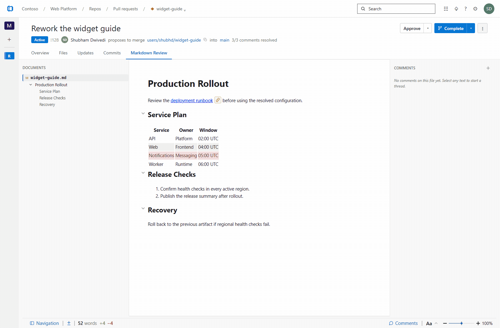

# Easy Markdown Review

[](https://github.com/shudv/easy-markdown-review-ado/actions/workflows/ci.yml)
[](https://github.com/shudv/easy-markdown-review-ado/releases/latest)
[](LICENSE)

Review Markdown like a document, directly in Azure DevOps. Comment on rendered
documents and see exactly what changed.



## Features

- **Pull-Request Tab:** Comment on rendered Markdown and see exactly what changed in a PR.
- **Document Hub:** Central place for all your Markdown documents with all the same reading and commenting capabilities. Understands Azure DevOps wiki syntax (`[[_TOC_]]`, `[[_TOSP_]]`, `.order`).
- **Equations and diagrams:** Render KaTeX math and Mermaid diagrams with source inspection.
- **Shareable review links:** Link to comments, headings, selected text, and a chosen PR update comparison.

> Requires only read scope for the repository and write scope for pull-request threads.

## Get started

1. [Install Easy Markdown Review from the Azure DevOps
   Marketplace](https://marketplace.visualstudio.com/items?itemName=ShubhamDwivedi.emr).
2. Open **Markdown Review** on a pull request that changes a `.md` file, or open
   **Documents** from the project navigation.
3. Select rendered text to comment, or turn on diffs to review semantic changes.

## A note on code quality

I built this because I needed it—and because I wanted to see how far I could push agentic coding to solve a real problem. Most of the codebase is agent-generated, so there is some slop in here.

To offset that, I have tried to enforce strict deterministic guardrails:

1. 100% statement and branch coverage.
2. Mutation testing must stay at or above 85%.
3. Function complexity is [pinned](complexity-baseline.json) (although this was done late so there are quite a few functions that don't meet the bar).
4. End-to-end tests covering the Azure DevOps integration boundary.
5. Visual regression tests to protect the UI.

But of course that is not enough. I will continue to improve the code quality, stability, and security over time as my schedule allows. Contributions are welcome.

## Development

Use Node.js 24+ and Git. No Azure DevOps account is needed to run the unit and
Storybook tests:

```pwsh
npm ci
npx playwright install chromium
npm run setup:hooks
npm test
```

Dependencies restore from public npm. The repository disables install scripts in
[`.npmrc`](.npmrc), so install the pre-commit hook explicitly with `setup:hooks`.

| Command                     | What it does                                                       |
| --------------------------- | ------------------------------------------------------------------ |
| `npm run storybook`         | Browse the UI with fake data at http://localhost:6006              |
| `npm run dev:ado`           | Open the dev extension in a browser with scoped localhost access   |
| `npm run build`             | Production build, bundle-size check, and dev-fault exclusion check |
| `npm run complexity`        | Report per-function cyclomatic and cognitive complexity            |
| `npm run complexity:update` | Lock in complexity improvements in the baseline                    |
| `npm run e2e`               | Run the Chromium integration suite once                            |
| `npm run e2e:soak`          | Repeat the Chromium integration suite twice                        |

Before opening a PR, run:

```pwsh
npm run typecheck; npm run typecheck:e2e; npm run lint; npm run format:check
npm run depcruise; npm run complexity:check; npm run test:complexity
npm run duplication:check; npm run test:coverage; npm run build
npm run test:visual:docker
```

CI also enforces the per-function complexity limits and pinned scores.
`complexity:check` fails when a pinned function gets simpler, so the gain is
recorded: run `npm run complexity:update` and commit the baseline. An intentional
increase needs `npm run complexity:update -- --accept`, which appears in the PR
diff.

CI also fails on copy-pasted code. `duplication:check` runs
[jscpd](https://github.com/kucherenko/jscpd) twice and lists every clone it
finds. Product code ([`.jscpd.json`](.jscpd.json)) fails above 0.25% duplicated
lines. Stories and tests ([`.jscpd.fixtures.json`](.jscpd.fixtures.json)) fail
above 3%. Extract a shared helper or fixture rather than raising a threshold.

The visual suite requires Docker. Azure DevOps integration tests require your
own sandbox and installed dev extension; see the [sandbox setup](sandbox/README.md),
[end-to-end test guide](e2e/README.md), and [visual regression guide](visual/README.md).

The [OSS sync ledger](docs/oss-sync.md) records the mirrored product boundary and
the configuration intentionally kept public-specific.
